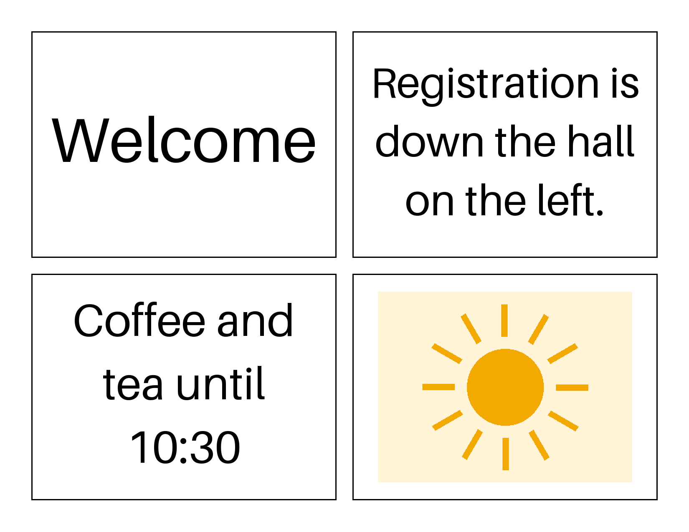
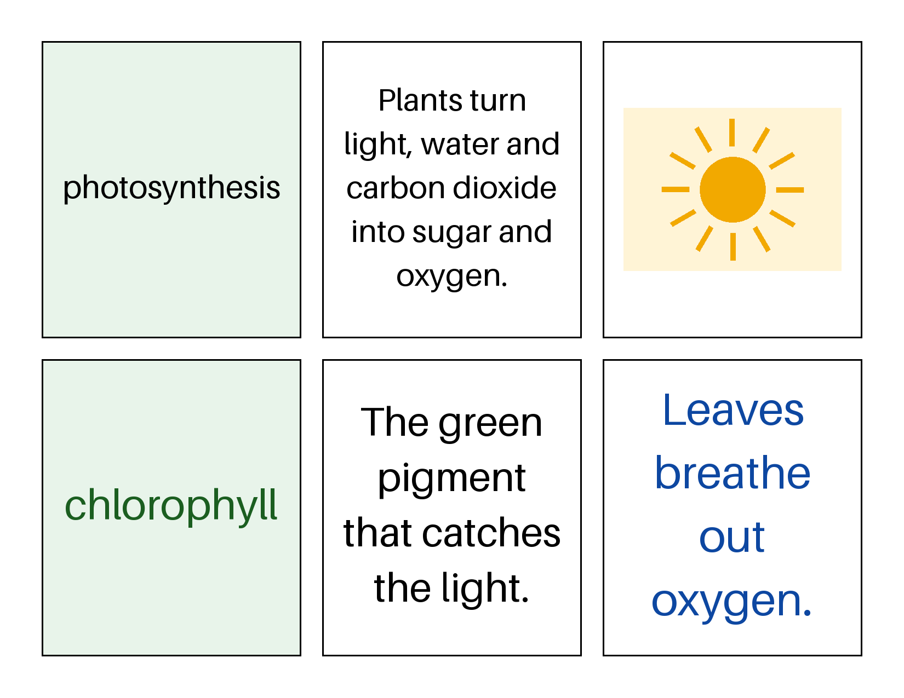

# poster-kreator

**Arrange equally spaced shapes on a page, each holding a plain text blob or an image,
and export it ready to print.**

[](https://github.com/EdwardScannell/poster-kreator/actions/workflows/ci.yml)


## Why

A word wall, a concept grid, an event sign, a cork-board notice: they are all the same
job. Put a handful of equal shapes on a page, space them evenly, and make the words or
pictures inside each one fit. Doing that by hand in a slide or word processor means
nudging boxes and shrinking fonts one at a time, and doing it again when one word
changes.

poster-kreator does the spacing and fitting for you. Describe the page and what goes in
each shape in a small JSON file; it lays the shapes out evenly and fits the content.

## What it is (and is not)

It **is** a layout engine for teachers, event organizers and anyone making a poster:
equal shapes, equal gaps, content that fits. It **is not** a design tool or a word
processor: there is no rich text, no bullets and no free placement.

| Principle | What it means |
|---|---|
| Equal spacing | Every shape is the same size, with the same gap between shapes |
| Plain content | A shape holds one plain text blob or one image |
| Content fits | Text wraps and shrinks to fit; images scale without distortion |
| Never clipped | If content cannot fit, the render fails and names the shape |
| Deterministic | The same spec renders the same image every time |

## Install

```bash
pip install -e ".[dev]"     # from a clone
make check                  # lint, strict types, tests with coverage
```

## Quick start

Describe the page and the shapes in JSON. Text is a plain blob; an image path is relative
to the spec file.

```json
{
  "cells": [
    {"content": {"kind": "text", "text": "Welcome"}},
    {"content": {"kind": "text", "text": "Registration is down the hall on the left."}},
    {"content": {"kind": "text", "text": "Coffee and tea until 10:30"}},
    {"content": {"kind": "image", "path": "sun.png"}}
  ]
}
```

```bash
poster render examples/four_square.json -o out/four_square.png
poster render examples/word_wall.json -o out/word_wall.png
poster layout examples/four_square.json     # where each shape sits: x y width height
```

```
1: 75 75 731 543
2: 844 75 731 543
3: 75 656 731 543
4: 844 656 731 543
```

Four shapes on a landscape page become a 2 x 2 grid; six become 3 x 2. Every shape is the
same size and every gap is the same.

| Four shapes | Six shapes |
|---|---|
|  |  |

## The model in one page

**The page.** Width and height in inches, a print resolution, a margin around the edge
and a gap between shapes. The default is US Letter, landscape, at 150 dpi.

**The cells.** Each cell is one shape and the one thing it holds: a plain text blob (one
color, no bullets) or an image file.

**The layout.** The engine places the shapes in an evenly spaced grid and picks the rows
and columns that make the shapes largest, unless you set `columns` yourself. A short last
row is centered with the same gap.

**The fit.** Text uses the font bundled with Pillow, so a spec renders the same way on
every machine. It is wrapped at word boundaries and set at the largest size that fits
inside the shape's padding; if one word is too wide even at the smallest size, the render
stops and names the shape. Images are scaled to fit and centered, never stretched.

## Layout

```
src/poster_kreator/
  model.py      the poster spec: page, cells, text and image content
  layout.py     equal-spacing grid: rows, columns and each shape's box
  fit.py        text wrapping and sizing, image scaling
  render.py     draw the shapes and their content; read a JSON spec
  cli.py        the `poster` command line (render, layout, shapes, version)
examples/       sample specs and the images they render
tests/
  unit/         one test file per module
  regression/   real bugs, each a permanent test
  fixtures/     sample specs and images
```

## Development

```bash
make check      # ruff, mypy --strict, pytest with coverage
```

The work ahead is in [`ROADMAP.md`](ROADMAP.md) and the repository's issues.
Contributions: see [`CONTRIBUTING.md`](CONTRIBUTING.md).

## License

Apache License 2.0. See [`LICENSE`](LICENSE) and [`NOTICE`](NOTICE).

## About

Built in small phases, one shape at a time: rectangles first, then triangles, squares,
ovals, diamonds, hexagons and stars, then mixed layouts, banners, borders and
print-ready export.
